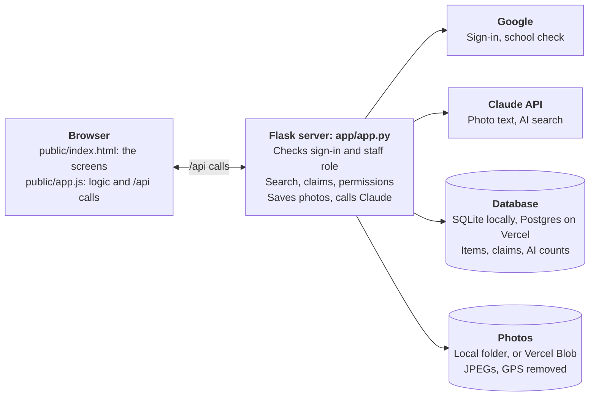
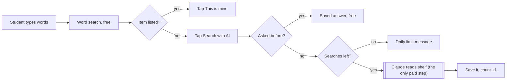

# Lost & Found Desk: Code Flow

How the code works, end to end: what runs where, how each request is checked, and the main flows (sign-in, logging an item, search, claims). For setup and deployment, see the [README](../README.md).

## Big picture

The app is one page in the browser talking to one Python server. The server owns all data and all rules: the page only shows what the server returns and sends back what people type or tap.

The page never reaches the database, the photos, Google or Claude directly. Every one of those goes through the server, which is where every rule is enforced.

- **Browser:** `public/index.html` (the screens) and `public/app.js` (the logic). It calls the server's `/api/...` endpoints with `fetch`.
- **Server:** `app/app.py`, a single Flask file. It checks who you are, reads and writes the database, saves photos, and calls Claude.
- **Storage:** chosen at start-up by what's configured.
  - **On your computer:** a SQLite file (`app/data/lostfound.db`) and a photo folder (`app/data/photos/`).
  - **On Vercel:** a Postgres database (Neon, from `DATABASE_URL`) and a private Vercel Blob store (from `BLOB_STORE_ID`), because Vercel's disk is temporary.
- **Outside services:** Google for sign-in, and the Claude API for photo descriptions and AI search.

| File | What it does |
| --- | --- |
| `app/app.py` | The whole server: settings, database, sign-in, permission checks, photo storage, AI calls, every API endpoint |
| `app/demo.py` | Loads and clears the demo data, for the Reset demo data button and `seed_mock.py` |
| `app/demo_data/` | The demo set: 121 items, 48 drawn photos, 4 claims |
| `app/seed_mock.py` | Command-line demo loader: `python seed_mock.py` or `--clear` |
| `app/.env.example` | Every setting, with notes. Copied to `.env` and filled in |
| `public/index.html` | Page layout and styles: sign-in screen, student view, staff tabs, claim form, photo viewer |
| `public/app.js` | Front-end logic: loads data, draws the screens, handles clicks, uploads photos, runs searches |
| `public/help.html` | The How it works guide at `/help` |
| `public/manifest.webmanifest` | App name, icons and colors, so phones can install it |
| `public/sw.js` | Service worker: keeps the app's own files on the phone and shows `offline.html` with no connection. Never stores API answers or photos |
| `public/offline.html`, `public/icons/` | The offline screen and app icons |
| `vercel.json` | Vercel settings: function time limit, `/` and `/help` routes |
| `requirements.txt`, `.python-version` | Python packages and version |
| `seed/build.py`, `seed/draw.py`, `seed/export_demo.py` | Generate the demo item list, draw the photos, and write `app/demo_data/` |
| `artifact.html` | The original prototype that runs only inside Claude |
| `docs/pitch.html` | One-page pitch |

## Start-up

When the server starts, `app.py` does four things in order:

1. **Picks storage.** `DATABASE_URL` (or `POSTGRES_URL` / `STORAGE_URL`) set → Postgres, else SQLite. `BLOB_STORE_ID` (or `BLOB_READ_WRITE_TOKEN`) set → Vercel Blob, else the local photo folder.
2. **Checks the setup on Vercel.** If the database or Blob store is missing, `CONFIG_PROBLEMS` lists what to add, and `config_check()` answers every request with a short "isn't set up yet" page instead of crashing.
3. **Creates the tables.** `init_db()` runs `SCHEMA`. Each statement is `CREATE TABLE IF NOT EXISTS`, so it's safe on every start.
4. **Loads the cookie-signing key.** `load_secret_key()` uses `SECRET_KEY` if set. Otherwise it creates a random key once and keeps it in the `app_settings` table, so every server instance and every restart signs login cookies the same way.

The `Postgres` class gives a Postgres connection the same small interface as SQLite (`execute`, `commit`, and so on, with `?` placeholders), so every query in the file works on both.

## Request lifecycle

Every API call passes the same three checks in the `signed_in()` decorator before any database work happens.

1. **The page sends the call.** `api()` in `app.js` adds the header `X-Requested-With: fetch` and sends the login cookie.
2. **Flask reads the login cookie.** It is signed with the secret key, so it can't be edited. It holds the email, name and role (`staff` or `student`).
3. **`signed_in()` checks the request:**
    - No email in the cookie → `401 Sign in first`. The page reloads to the sign-in screen.
    - The endpoint is staff-only and the role isn't `staff` → `403`.
    - A change (POST, PATCH, DELETE) without the `X-Requested-With` header → `400`. This blocks forged requests from other sites.
4. **The endpoint runs.** It reads or writes the database through `db()`, always with `?` placeholders, never by pasting text into SQL.
5. **JSON comes back.** The page updates its state and redraws.

| Endpoint | Who can call it | What it does |
| --- | --- | --- |
| `GET /api/me` | Anyone | Who's signed in, their role, whether AI is on, whether it's test mode |
| `GET /api/items` | Signed in | Students: items on the shelf, without storage spot. Staff: everything |
| `POST /api/search` | Signed in | Word search, or AI search when `ai: true` |
| `GET /api/claims/mine` | Signed in | The signed-in student's own claims |
| `POST /api/claims` | Signed in | Make a claim |
| `POST /api/describe` | Staff | AI reads the photos and returns a description |
| `POST /api/items` | Staff | Save a new item with photos |
| `PATCH /api/items/<id>` | Staff | Change storage spot, mark returned or back on shelf |
| `DELETE /api/items/<id>` | Staff | Delete an item, its photos and its claims |
| `GET /api/claims` | Staff | All claims, pending first |
| `POST /api/claims/<id>/decide` | Staff | Approve or decline a claim |
| `POST /api/demo/reset` | Staff, test mode only | Replace the demo items and claims with a fresh set |
| `GET /photos/<name>` | Signed in | One photo, from the folder or from Blob |

On Vercel, `public/` files are served straight from Vercel's CDN, and `vercel.json` maps `/` to `index.html` and `/help` to `help.html`. Every other path goes to the Flask function. Running locally, Flask serves those same files itself.

## Sign-in flow

Sign-in is Google's standard "Sign in with Google" flow, handled by the Authlib library. The app adds two checks of its own: the account must be school-managed, and staff are a fixed email list.

1. **Page loads.** `boot()` calls `GET /api/me`. Not signed in → `showSignIn()` shows the Google button (and the demo buttons when `DEV_LOGIN=1`).
2. **Student clicks Sign in with Google** → `GET /login`. `login()` sends them to Google, asking only for `openid email profile`. With one school domain, it passes `hd` so Google's picker shows only school accounts.
3. **Google sends them back** to `GET /auth/callback`. `auth_callback()` gets the verified email, name and `hd` (the Workspace domain Google vouches for).
4. **`email_allowed()` checks the account.** The email's domain must be in `ALLOWED_DOMAINS`, and `hd` must match it. A personal Gmail has no `hd`, so it fails. Failure → back to the sign-in screen with "That account isn't a school account".
5. **`start_session()` writes the login cookie:** email, name, and role. Role is `staff` if the email is in `STAFF_EMAILS`, otherwise `student`.
6. **Page reloads**, `/api/me` now answers with the user, and the right view appears.

**Test mode.** With `DEV_LOGIN=1`, `GET /dev-login?email=...&role=...` skips Google and calls `start_session()` directly. It returns 404 when `DEV_LOGIN` is off. Anyone with the link can act as staff in test mode, so use it with demo data only.

**Sign out.** `GET /logout` clears the cookie.

**Known gap:** the role is set once at sign-in. Removing someone from `STAFF_EMAILS` takes effect at their next sign-in, not immediately.

## Staff logs an item

Logging an item makes at most one AI call, and only after the last photo is in. Photos are shrunk in the browser, then re-encoded on the server, which strips GPS data.

1. **Add photos.** The file input opens the phone camera. `addPhotos()` shrinks each photo to 1600 px with `shrink()` (a canvas redraw) and keeps up to 3 in `S.draft.photos`. Shrinking also keeps uploads under Vercel's 4.5 MB request limit.
2. **Wait for the last photo.** `scheduleDescribe()` starts a timer: 2.5 seconds after the last photo, or right away once there are 3. Adding another photo restarts the timer.
3. **One AI call.** `describe()` posts the photos to `POST /api/describe`. The server's `describe()` shrinks them to 1200 px and sends them to Claude with `DESCRIBE_PROMPT` through `ask_claude_json()`. Claude returns a name, category, color, brand, details and search words as JSON.
4. **Fill the form.** The page fills each field unless staff already typed in it (the `touched` flag), then marks the draft `described`. Removing a photo doesn't call AI again. "Read the photos again" forces a new call.
5. **Save.** `saveItem()` checks that there's a photo, a storage spot and a name, then posts everything to `POST /api/items`. Search words come from the keywords box through `parseKeywords()`.
6. **Server saves it.** `create_item()` calls `save_photo()` for each photo: it fixes rotation, shrinks to 1600 px, re-encodes as JPEG (dropping GPS and other photo data), and hands it to `store_photo()` under a random name, which writes to the folder or to Blob. Then `new_tag()` picks an unused tag like `LF-6514`, and the item row is inserted with status `available`.
7. **Done.** The page shows "Write LF-6514 on a sticky note", clears the form with `resetLog()` and reloads the lists.

Without an API key, step 3 is skipped: the status line says to type the details, and everything else works the same.

## Student search

Every search starts with free word matching on the server. AI runs only when the student taps Search with AI, and a repeat of the same AI search on an unchanged shelf is answered from memory.

**Word search** (`keyword_search()` in `app.py`):

1. **Clean the words.** Lowercase, drop filler words in `STOP` (my, the, lost, near...), join phrases like "dark blue".
2. **Weigh them.** Item-type words (any word in `SYNONYM_GROUPS`, like hoodie or bottle) count 2. Other words, like colors, count 1.
3. **Score each item on the shelf.** Its name, category, color, brand, details, keywords and found-where are joined into one block of text. A word found as typed gets full credit. A word found only through a synonym ("sweatshirt" matching "hoodie") gets 60%. Score = credit earned ÷ credit possible.
4. **Rank and trim.** Highest score first, newest first on ties. If the best score is 0.5 or more, items under 0.34 are dropped. Top 8 come back labeled high (0.7+), medium (0.4+) or low.

**AI search** (`search()` with `ai: true`):

1. **Check the memory.** The key is the cleaned, sorted search words plus `shelf_version()`, which changes whenever an item is added, removed, returned or put back. A hit returns the stored answer, free, and doesn't count toward the cap. The memory is per server instance, so on Vercel a repeat can occasionally miss it and cost one more call.
2. **Check the daily cap.** `ai_left()` reads today's count from the `ai_usage` table. At 0 → `429` with "You've used today's 20 AI searches". Staff have no cap.
3. **Ask Claude.** Up to 300 items on the shelf go into one prompt (name, category, color, brand, details, keywords, where and when found), with the student's words. Claude returns up to 6 item ids, each with a confidence and a one-line reason.
4. **Check and store the answer.** Ids that aren't on the shelf are dropped. The answer is saved in memory, and `count_ai_search()` adds 1 to the student's count for today.

**On the page,** `runSearch()` sends the search and `renderStudent()` draws the cards. After a word search, the Search with AI panel appears. It sits above the results when every match is low, below them otherwise. If AI fails, a message appears and the word results stay on screen.

## Claim and approval flow

A claim is one row per student per item, and approving one closes the rest. Each claim moves from `pending` to `approved` or `declined`, and never back.

1. **Student taps This is mine.** `openClaim()` opens the form with their Google name filled in.
2. **Student sends it.** `submitClaim()` posts the item id, name, grade and proof to `POST /api/claims`.
3. **Server checks and saves.** `create_claim()` confirms the item is still on the shelf (else `404`) and that name and proof are filled in. The table's rule of one claim per student per item turns a second try into `409 You already claimed this item`.
4. **Staff see it.** `GET /api/claims` lists pending claims first, each with the item's details and storage spot. The Claims tab shows the pending count.
5. **Staff decide.** `decide()` handles both buttons:
    - **Approve:** the claim becomes `approved`, the item becomes `returned` (with time and student), and every other pending claim on that item becomes `declined` with the note "It was returned to its owner".
    - **Decline:** only that claim becomes `declined`.
    - A claim that's already decided → `404`, so two staff clicking at once can't double-approve.
6. **Student sees the result** under My claims: approved shows the tag to ask for at the office, declined shows the note.

Staff can also mark an item returned or put it back on the shelf without any claim, through `PATCH /api/items/<id>`. Deleting an item deletes its claims and photos too.

## Demo data

The **Reset demo data** button (staff, test mode only) calls `POST /api/demo/reset`, which runs `demo.load()`:

1. **Clear the old demo.** Every row marked `mock = 1` is deleted, with its photos. Items and claims staff created stay.
2. **Load the set** from `app/demo_data/items.json`. Each item's date is stored as "days ago", so the demo always looks recently found. Photos are saved under new random names through `store_photo()`.
3. **Add 4 pending claims**, including two students claiming the same hoodie, to show the auto-decline.

`python seed_mock.py` does the same from the command line, against whatever storage `.env` points at.

## Data model

Four tables, created by `SCHEMA` in `init_db()` when the server starts. The same tables work in SQLite and Postgres. Students never receive the staff-only columns: `item_json()` removes them before the data leaves the server.

**items**: one row per found item.

| Column | Holds | Students see it |
| --- | --- | --- |
| `id` | Random 12-character id | Yes |
| `tag` | `LF-1234`, unique, for the sticky note | Yes |
| `title`, `category`, `color`, `brand`, `description` | What the item is | Yes |
| `keywords` | Search words, a JSON list | Yes |
| `photos` | Photo file names, a JSON list, sent as `/photos/...` links | Yes |
| `found_where`, `found_at` | Where and when it was found | Yes |
| `status` | `available` or `returned` | Only `available` items reach students |
| `location` | Storage spot | No |
| `logged_by` | Email of the staff member who logged it | No |
| `returned_at`, `returned_to` | When and to whom it went back | `returned_to`: no |
| `mock` | 1 for demo data | No |

**claims**: one row per student per item (`UNIQUE(item_id, student_email)`).

| Column | Holds |
| --- | --- |
| `item_id`, `student_email` | Which item, which student |
| `name`, `grade`, `proof` | What the student typed |
| `status`, `note` | `pending`, `approved` or `declined`, plus a note when auto-declined |
| `created_at`, `decided_at` | Timestamps in milliseconds |
| `mock` | 1 for demo data |

Students only ever get their own claims, from `/api/claims/mine`. Staff get everything, including the student's email.

**ai_usage**: one row per student per day: `email`, `day`, `count`. It powers the daily AI search cap.

**app_settings**: `name`, `value`. Holds the generated cookie-signing key when `SECRET_KEY` isn't set.

Photos are named with 32 random hex characters, in `app/data/photos/` or under `photos/` in the Blob store. `photo()` serves them only to signed-in users and rejects any name that doesn't match that pattern. From Blob, it fetches the file with the store's credentials and sends it on, since a private Blob URL can't be opened directly.

## Front-end structure

`app.js` follows one pattern: all data lives in one state object `S`, and the screen is redrawn from it after every change. There's no framework and no build step.

- **State, `S`:** the signed-in user (`me`), staff or student view (`mode`), items on the shelf, the student's claims, all claims for staff, the item being logged (`draft`), the last search (`search`), and which tab and filter are open.
- **Loading, `loadAll()`:** fetches items and claims (all claims too, for staff), puts them in `S`, and calls `render()`. It runs at start, after every change, every 60 seconds, and when the tab comes back into view.
- **Drawing, `render()`:** shows the staff or student view, then calls `renderStaff()` or `renderStudent()`. Both rebuild their lists as HTML strings. `cardHTML()` draws one item card, `statusPill()` one claim status. Every piece of text from the server goes through `esc()` first, so typed text can't run as code.
- **Clicks:** one listener on the whole page reads each button's `data-action` (`claim`, `aiSearch`, `approve`, `delItem`, `demoReset`...) and calls the matching function. Delete and Reset demo data need a second click to confirm.
- **Server calls, `api()`:** one helper adds the header, turns errors into readable messages, and reloads the page on a `401`.
- **Changes, `act()`:** runs a server call, shows a toast like "Marked returned.", then calls `loadAll()`.
- **Photos:** `shrink()` resizes each photo on a canvas before upload, and `openPhotos()` shows all of an item's photos in a full-screen viewer.

## Installing as an app

The site is a PWA, so phones and Chromebooks can install it without an app store.

1. **The page points to the app info.** `index.html` links `manifest.webmanifest` (name, icons, navy theme, full-screen) and the iPhone icon.
2. **`app.js` registers `sw.js`** once the page has loaded.
3. **The install button.** On Android, Chrome and Edge, the browser fires `beforeinstallprompt`. The page keeps it and shows **Install app** in the header. iPhone Safari has no such event, so the page shows a one-time hint, "tap Share, then Add to Home Screen", until the student taps **Got it**.
4. **The service worker:**
    - **Pages:** network first, then the saved copy, then `offline.html`.
    - **The app's own files:** the saved copy first, refreshed in the background.
    - **Never saved:** `/api`, `/photos` and sign-in requests always go to the server.
5. **Offline at start-up.** If `/api/me` can't be reached twice in a row, the page switches to the offline screen. **Try again** goes back to the app.

To ship a change to the saved files, bump `VERSION` in `sw.js`. Phones then fetch the new set and drop the old one.

## Where to change things

| To change | Edit |
| --- | --- |
| Who can sign in, who is staff | `ALLOWED_DOMAINS`, `STAFF_EMAILS` in `.env` or Vercel's Environment Variables |
| AI searches per student per day | `AI_SEARCHES_PER_DAY` |
| Which Claude model is used | `CLAUDE_MODEL` |
| Where data is stored | `DATABASE_URL` and `BLOB_STORE_ID`: set means Postgres and Blob, empty means local files |
| Words that mean the same thing in search | `SYNONYM_GROUPS` in `app/app.py` |
| Filler words search ignores | `STOP` in `app/app.py` |
| How word search ranks results | `keyword_search()` in `app/app.py`: the 2/1 weights, the 60% synonym credit, the cut-offs |
| What AI writes about a photo | `DESCRIBE_PROMPT` in `app/app.py` |
| How AI picks search matches | The prompt inside `search()` in `app/app.py` |
| Item categories | `CATEGORIES` in `app/app.py` |
| What students can and can't see | `item_json()`, `list_items()`, `my_claims()` in `app/app.py` |
| A new database column | `SCHEMA` in `app/app.py`, plus the insert in `create_item()` (and `demo.py` for demo rows) |
| Page wording and layout | `public/index.html` |
| What a card or claim shows | `cardHTML()`, `renderStudent()`, `renderStaff()` in `public/app.js` |
| Photo size and quality | `save_photo()` in `app/app.py`, `shrink()` in `public/app.js` |
| Help page text | `public/help.html` |
| Demo data | `seed/build.py`, then `python seed/export_demo.py` |
